<p>
  <a href="#destaques"><b>Destaques</b></a> &nbsp;/&nbsp;
  <a href="#stack"><b>Stack</b></a> &nbsp;/&nbsp;
  <a href="#stats"><b>Stats</b></a> &nbsp;/&nbsp;
  <a href="https://github.com/rianprei?tab=repositories"><b>Todos os repositórios</b></a>
</p>

<p>
  <a href="https://github.com/rianprei?tab=followers"></a>
  <a href="https://github.com/rianprei?tab=repositories"></a>
</p>

> Comecei com CSS em 2025. Hoje porto ferramentas para o Termux, mexo no kernel do meu celular e construo tooling local para agentes de código.

- Frontend com React + Tailwind
- Termux sem root, sem proot
- Kernel e Magisk no POCO C75
- Proxies Rust para o Claude Code
- Tooling local para agentes de IA

## Destaques

| Projeto | O que faz |
| :--- | :--- |
| **[termux-builder](https://github.com/rianprei/termux-builder)**<br>[](https://github.com/rianprei/termux-builder) <sub>Python</sub> | Android Studio no Termux: build de APK sem root e sem PC |
| **[termux-adb](https://github.com/rianprei/termux-adb)**<br>[](https://github.com/rianprei/termux-adb) <sub>Shell</sub> | ADB e Fastboot no Termux sem root: USB OTG, wireless, scrcpy |
| **[homebrew-termux](https://github.com/rianprei/homebrew-termux)**<br>[](https://github.com/rianprei/homebrew-termux) <sub>Shell</sub> | Homebrew nativo no Termux, sem root, proot ou emulação |
| **[winget-termux](https://github.com/rianprei/winget-termux)**<br>[](https://github.com/rianprei/winget-termux) <sub>C++</sub> | Port nativo ARM64/bionic de um subconjunto real do winget-cli |
| **[bepInEx-termux](https://github.com/rianprei/bepInEx-termux)**<br>[](https://github.com/rianprei/bepInEx-termux) <sub>C++</sub> | Instrumentação nativa via Zygisk + Dobby, estilo BepInEx |
| **[poco-c75-lake-kernel](https://github.com/rianprei/poco-c75-lake-kernel)**<br>[](https://github.com/rianprei/poco-c75-lake-kernel) <sub>Shell</sub> | Build reproduzível do kernel GKI 6.6.89 para POCO C75, testado em boot |
| **[claude-nim](https://github.com/rianprei/claude-nim)**<br>[](https://github.com/rianprei/claude-nim) <sub>Rust</sub> | Proxy da Anthropic Messages API para NVIDIA NIM, binário único ~2 MB |
| **[opencode-ultrareview](https://github.com/rianprei/opencode-ultrareview)**<br>[](https://github.com/rianprei/opencode-ultrareview) <sub>Shell</sub> | 5 revisores adversariais com gate de evidência, 100% local |

<details>
<summary><b>todos os projetos por área</b></summary>
<br>

**Android / Termux:** [termux-cmd](https://github.com/rianprei/termux-cmd) · [termux-flatpak](https://github.com/rianprei/termux-flatpak) · [scrcpy-wayland-android](https://github.com/rianprei/scrcpy-wayland-android) · [shizuku-termux](https://github.com/rianprei/shizuku-termux)

**Kernel / root (POCO C75):** [poco-perfgov-magisk](https://github.com/rianprei/poco-perfgov-magisk) · [termux-adb-magisk-rootport](https://github.com/rianprei/termux-adb-magisk-rootport) · [ultraroot-ultrakernel](https://github.com/rianprei/ultraroot-ultrakernel)

**Proxies para Claude Code (Rust):** [grok-proxy-cc](https://github.com/rianprei/grok-proxy-cc) · [antigravity-proxy-cc](https://github.com/rianprei/antigravity-proxy-cc) · [codex-proxy-cc](https://github.com/rianprei/codex-proxy-cc)

**Tooling para agentes:** [opencode-ultraplan](https://github.com/rianprei/opencode-ultraplan) · [opencode-ultragoal](https://github.com/rianprei/opencode-ultragoal) · [opencode-handoff](https://github.com/rianprei/opencode-handoff) · [snapedit](https://github.com/rianprei/snapedit) · [toke-local](https://github.com/rianprei/toke-local) · [prompt-engineering-master](https://github.com/rianprei/prompt-engineering-master) · [hermes-autonomous-dev](https://github.com/rianprei/hermes-autonomous-dev)

**Outros:** [maestri-bin-archlinux](https://github.com/rianprei/maestri-bin-archlinux) · [hyperdnsx](https://github.com/rianprei/hyperdnsx) · [opencode-engineering](https://github.com/rianprei/opencode-engineering)

**Onde tudo começou (2025, frontend):** [uma-arvore-de-projetos](https://github.com/rianprei/uma-arvore-de-projetos) · [Blog-Preview-Card](https://github.com/rianprei/Blog-Preview-Card) · [poke-api](https://github.com/rianprei/poke-api) · [Testando-uns-baguio-ai-com-zod](https://github.com/rianprei/Testando-uns-baguio-ai-com-zod) · [QR code](https://github.com/rianprei/Desafio-do-Frontend-Mentor---QR-code-component-solution) · [Social links](https://github.com/rianprei/Desafio-do-Frontend-Mentor---Social-links-profile-solution) · [Blog preview card](https://github.com/rianprei/Desafio-do-Frontend-Mentor---Blog-preview-card-solutionr)

</details>

## Stack

**Frontend**

<p>
  
  
  
  
  
  
</p>

**Linux**

<p>
  
  
  
</p>

<sub>também nos meus projetos</sub>

<p>
  
  
  
  
  
  
  
  
  
</p>

<details>
<summary><b>whoami</b></summary>

```console
┌──(rian㉿cachyos)-[~]
└─$ whoami
Rian  ·  rianprei

┌──(rian㉿cachyos)-[~]
└─$ cat stack
front : HTML · CSS · JavaScript · TypeScript · React · Tailwind
os    : Ubuntu · Arch Linux · CachyOS
alvo  : Android · Termux · Magisk · POCO C75
repos : Rust · C · C++ · Shell · Python · Go

┌──(rian㉿cachyos)-[~]
└─$ uptime
no GitHub desde 2025-03
```

</details>

## Stats

<picture>
  <source media="(prefers-color-scheme: dark)" srcset="https://github-stats-extended.vercel.app/api?username=rianprei&show_icons=true&hide_border=true&rank_icon=github&bg_color=00000000&title_color=6CA0FF&icon_color=FFD21F&text_color=C9D1D9&ring_color=4C8DFF">
  
</picture>

<picture>
  <source media="(prefers-color-scheme: dark)" srcset="https://streak-stats.demolab.com/?user=rianprei&hide_border=true&background=00000000&ring=4C8DFF&fire=FFD21F&currStreakNum=F0F6FC&currStreakLabel=6CA0FF&sideNums=F0F6FC&sideLabels=9198A1&dates=9198A1&stroke=3D444D">
  
</picture>

## Contato

<p>
  <a href="https://github.com/rianprei"></a>
  <!-- PREENCHER: outras redes (LinkedIn, X, site), mesmo estilo de badge: https://img.shields.io/badge/<nome>-0A2472?style=flat-square&logo=<simple-icons-slug>&logoColor=FFD21F -->
</p>

<sub><code>termux-setup-storage && make it work</code></sub>
